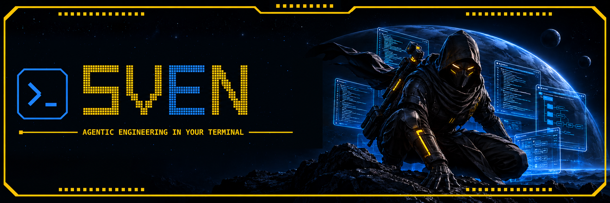
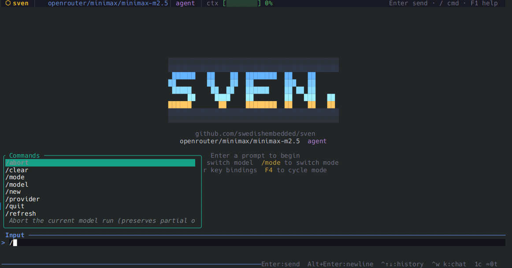

# Agent Sven

**A keyboard-driven AI agent for the terminal.** Built in Rust, sven works as
an interactive TUI and as a headless CI runner - one HSM kernel behind every
surface.

[](https://github.com/swedishembedded/sven/actions/workflows/ci.yml)
[](LICENSE)
[](CHANGELOG.md)



Give sven a task in plain English. It reads your code, runs commands, writes
files, searches the web, and delegates subtasks to sub-agents - all
autonomously, all in your terminal - or headless in CI, driven by markdown
workflow files.

## Three projects, one stack

sven is one of three open projects that work together. Each one stands on its
own:

| Project | Its role |
|---|---|
| **[sven](https://github.com/swedishembedded/sven)** (this repository) | **Runs the agent.** A terminal AI agent that reads code, runs tools and works through tasks, interactively or headless in CI. |
| **[brain](https://github.com/swedishembedded/brain)** | **Runs the models.** Inference, training, fine-tuning and serving on your own hardware; sven can use it as a local model provider ([Running on Brain](#running-on-brain)). |
| **[Splinter](https://github.com/mkschreder/splinter)** | **Turns agent experience into better local models.** It runs sven on real tasks, checks the results, trains a model with brain, and releases it only when held-out tests show it improved. |

sven works with any of its model providers; it needs neither of the other two.

## Documentation

**Full documentation: <https://swedishembedded.com/docs/sven>**. The same pages
live in [docs/](docs/index.md) and read well on GitHub; [docs/manifest.yaml](docs/manifest.yaml)
lists them in order.

- [Installation](docs/getting-started/installation.md) and [Quick start](docs/getting-started/quickstart.md)
- Guides: [interactive use](docs/guides/interactive.md), [headless and CI](docs/guides/headless.md),
  [workflow files](docs/guides/workflows.md), [teams](docs/guides/teams.md),
  [GDB debugging](docs/guides/debugging.md), [harnesses](docs/guides/harnesses.md)
- Concepts: [agents and modes](docs/concepts/agents.md), [state machines](docs/concepts/state-machines.md),
  [memory](docs/concepts/memory.md)
- Reference: [command line](docs/reference/cli.md), [configuration](docs/reference/configuration.md),
  [providers](docs/reference/providers.md), [tools](docs/reference/tools.md),
  [SDK](docs/reference/sdk.md), [MCP](docs/reference/mcp.md), [ACP](docs/reference/acp.md)

## What sven does

- **One kernel behind every surface.** Control flow is a hierarchical state
  machine; the model proposes actions and never drives execution. The TUI,
  headless runs, ACP and MCP all drive the same kernel.
- **Interactive and headless.** A keyboard-driven terminal UI, or stdin and
  Markdown workflow files in CI, pipeable into one another.
- **Modes.** `agent` (default), `chat`, `research`, `plan` and `sdlc`; see
  [Agents and modes](docs/concepts/agents.md) for what each may do and how
  approvals apply.
- **Tools and delegation.** Files, search, shell, web, context, GDB, and sub-agents
  through the `task` tool; teams of agents with a shared task board.
- **Memory, skills and project knowledge** that persist across sessions.
- **More than thirty model providers**, MCP client and server, and ACP for editors.
- **A framework.** `sven-sdk` embeds the kernel in your own application;
  [harnesses](docs/guides/harnesses.md) define agents as YAML programs.

A harness for a job says what must be true, and sven makes it so or fails:

```yaml
api_version: "2"
name: verified-task
inputs: { feature: string }
execution: { limits: { model_turns: 12 } }
gates:
  test: { command: [sh, run_tests.sh], timeout: 300 }
workflow:
  - name: implement
    task: "Implement: {{ inputs.feature }}"
    verify: [test]          # the exit status decides, not the agent
    repair: { attempts: 2 }
```

`sven harness run` drives it with a real model and real tools;
`sven harness test` runs the same document against mock cases, offline. See the
[harness guide](docs/guides/harnesses.md).

## Install

```sh
curl -fsSL https://agentsven.com/install.sh | sh
```

or build from source (a recent stable Rust toolchain is all you need):

```sh
make build/release
export PATH="$PWD/target/release:$PATH"
sven --version
```

## Quick start

Export a key for a hosted provider (`OPENROUTER_API_KEY`, `ANTHROPIC_API_KEY` or
`OPENAI_API_KEY`), or run a local model with brain (below), then:

```sh
sven doctor provider                  # can sven reach a model?
sven                                  # interactive TUI
sven "Summarise the project"          # one-shot, headless
sven --file plan.md                   # multi-step workflow file
```

## Running on Brain

[brain](https://github.com/swedishembedded/brain) serves models on your own
machine, so sven works with no cloud account and nothing leaving the computer.
With brain serving an OpenAI-compatible endpoint, sven finds it from brain's
keys file and asks it which model it serves; see
[Brain in the provider reference](docs/reference/providers.md#brain-local-edge-ai-server)
and [brain's documentation](https://swedishembedded.com/docs/brain) for serving
a model.

## Building and contributing

```sh
make build        # debug build
make test         # unit and integration tests
make check        # rustfmt, text gates, architecture ratchet, clippy
make docs         # documentation publication (build/docs) and the manual
```

See [docs/contributing](docs/contributing/index.md) and [AGENTS.md](AGENTS.md).
Open an issue or pull request on [GitHub](https://github.com/swedishembedded/sven);
for larger changes, open an issue first.

## License

Licensed under the [Apache License 2.0](LICENSE). See [CHANGELOG.md](CHANGELOG.md) for version history.
