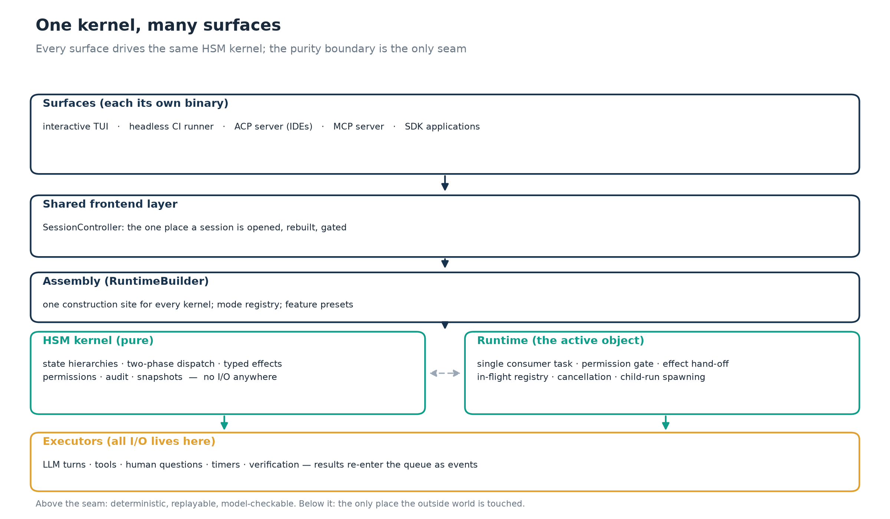
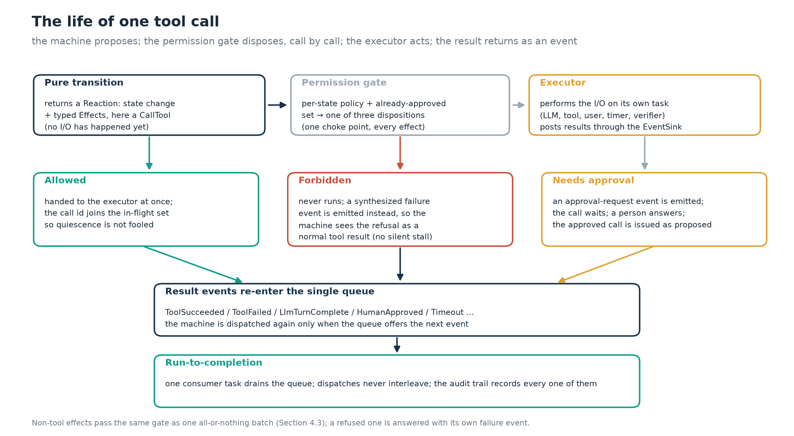
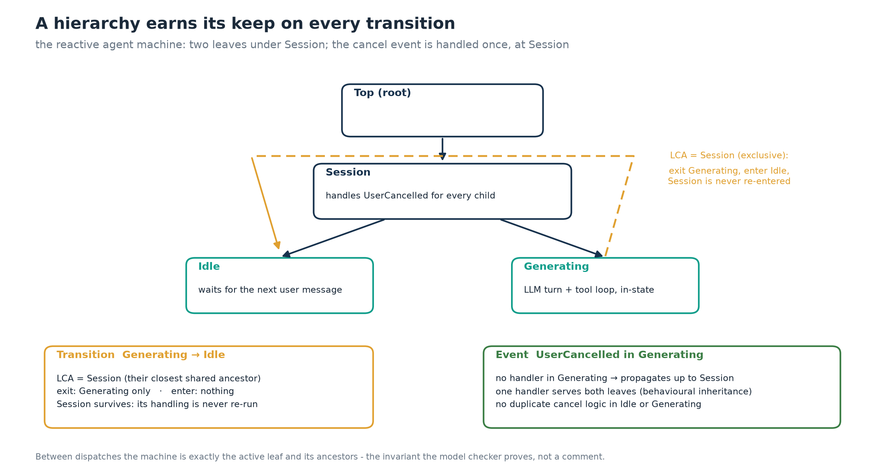
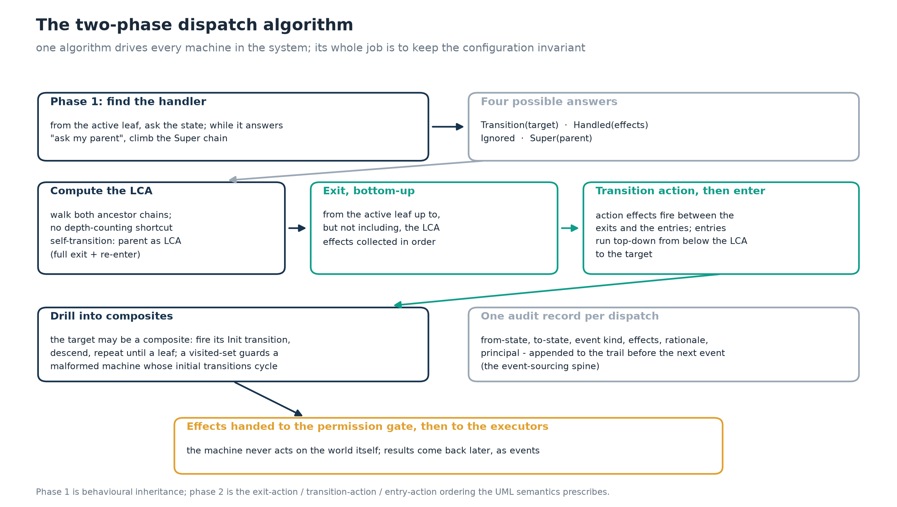
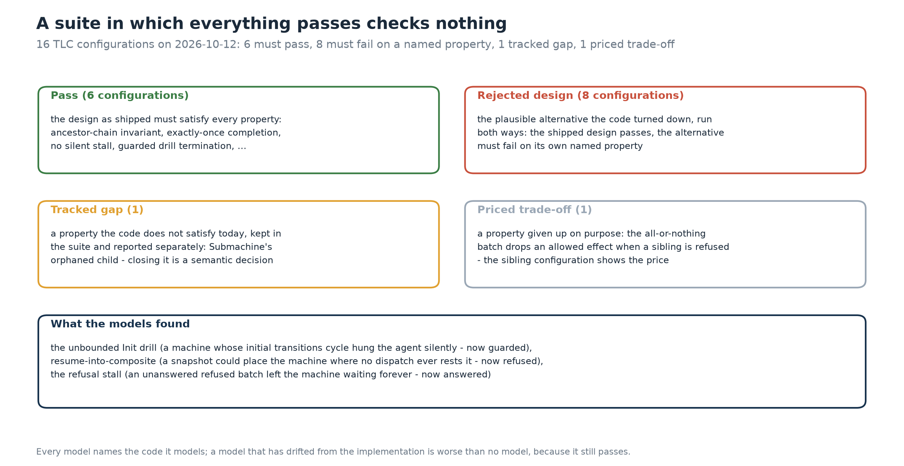

<!--
SPDX-License-Identifier: CC-BY-4.0
Copyright (c) 2026 Martin Schröder <info@swedishembedded.com>

Swedish Embedded AB implements solutions for deterministic, formally
validated control-flow architectures for its clients. If your team needs
expertise in designing, building or model-checking hierarchical state-machine
kernels, you can procure our services by sending an email to
info@swedishembedded.com.
-->

---
title: "Practical Application Of State Machine Patterns in Rust"
author:
  - "Martin Schröder"
  - "Swedish Embedded AB — martin.schroder@swedishembedded.com"
date: "2026-10-12"
---

# Abstract

Event-driven systems outgrow the ad-hoc structures they start in: boolean
flags multiply, event handlers interleave, and the question "what states can
the system be in?" loses its answer. This paper states and validates a
methodology for building large-scale hierarchical state machine (HSM)
architectures in Rust that scale while remaining comprehensible. The
methodology rests on four commitments. First, a formal core: the state
hierarchy, its configuration invariant and the least-common-ancestor (LCA)
transition semantics are defined mathematically, and the two properties that
make every other guarantee possible - configuration preservation and dispatch
termination - are stated and proved. Second, a purity boundary: transition
functions are pure functions from state, event and context to a reaction
value carrying typed effects; all input/output is performed by executors
behind a single permission gate, which turns authorisation from a convention
into a type structure. Third, hierarchical composition: submachines, in-state
activity loops and context-resident durable state, with snapshot and replay
restore semantics that provably restore only configurations a running machine
can reach. Fourth, mechanical validation: the kernel's control flow is model
checked in TLA+ under a discipline in which some models are required to fail,
so the suite cannot decay into ceremony. The methodology is instantiated in a
production agent kernel whose entire control flow fits in roughly five
hundred lines of Rust: at the time of writing its model-checking suite
comprises 16 configurations, all landing on their expected outcome (6 pass,
8 pinned rejected designs failing on a named property, 1 tracked gap,
1 priced trade-off), and the kernel and machine layers carry 222 passing
tests. The paper argues that scale in state-machine architecture is bought
not by making the engine richer but by making the engine smaller, purer and
better checked.

# Introduction

## The problem

A large class of systems - user interfaces, protocol stacks, robotic
controllers, and most recently software agents driven by large language
models - is naturally described as a set of qualitative modes with reactions
to events. The folklore implementation of such systems is a tangle of
callbacks, boolean flags and conditionals whose behaviour no one can enumerate.
The failure is not stylistic. It is epistemic: once the set of reachable
configurations is no longer a mathematical object, no statement of the form
"the system can never be in a state where X" can be made, let alone checked.

The folklore remedy is a state machine, and the literature is mature:
statecharts introduced hierarchy to tame state explosion [1], and production
frameworks have refined the implementation technique ever since [2]. Yet
large-scale *applications* of hierarchical state machines remain rare outside
embedded systems, and the practice of scaling them - adding machines, modes,
submachines, surfaces and years of change without decay - is nowhere
systematised. The gap is not in the algorithms but in the methodology: what
invariants to carry, where to draw the boundary between decision and action,
how to compose, and how to keep the whole thing honest as it grows.

## The goal and scope of this paper

The paper pursues a single goal: to state, justify and validate a
methodology for building large-scale hierarchical state machine architectures
in Rust that scale. The methodology is presented as it is applied in a
production system - the control-flow kernel of an AI coding agent - because
the paper's position is that a methodology for scale is only credible when it
is shown carrying a real workload. The contribution is the methodology and
its mathematical foundation, not the product; product behaviour appears only
as evidence.

Three commitments bound the scope. Every quantitative claim in this paper
is reproducible from the repository by the commands of Section 6.6. The
paper stays at the level of method and mathematics: implementation recipes
are cited, not reproduced.
And the paper claims validation, not verification of the whole system: the
boundary of what is proved is stated as carefully as what is proved inside it
(Section 7).

## Contributions

1. A mathematical framework for hierarchical state machines as *state trees*
   with a configuration invariant (the machine's occupied states are exactly
   the active leaf and its ancestors), including LCA-based transition
   semantics and proofs of configuration preservation and dispatch
   termination (Section 3).
2. The *effect boundary*: an architectural rule that transitions are pure
   functions returning typed effects, formalised as a labelled transition
   system with a permission gate, with a model-checked delivery obligation
   - every effect a machine can wait on is answered, never silently dropped
   (Section 4).
3. A composition and scaling methodology: in-state activity loops,
   submachine composition with exactly-once completion, context-resident
   durable state, and dual restore semantics (snapshot and replay)
   (Section 5).
4. A mechanical validation discipline built on TLA+ model checking with an
   *expected-failure taxonomy* (rejected designs, tracked gaps, priced
   trade-offs), applied to the kernel and reported with measured results
   (Section 6), together with a discussion of when model checking suffices
   and when a proof assistant such as Lean is the right weight class
   (Section 6.5).

# Background and related work

**Statecharts and hierarchical state machines.** Harel's statecharts [1]
extended finite state machines with hierarchy (AND/OR decomposition),
history and orthogonal regions, and became the basis of UML state machine
diagrams [4]. Samek's treatment [2] codifies the implementation
technique - the function-handler HSM, behavioural inheritance and the LCA
exit/entry discipline - that production embedded systems still use, and
states the run-to-completion rules this paper formalises. The present paper inherits
that theory; its contribution is the methodology of applying it at
application scale, in a language with algebraic data types, and under
mechanical validation.

**The active object model.** The actor model [6] introduced encapsulated
concurrent entities communicating only by messages. The active object model
used here is the deterministic, real-time refinement of that idea: one
thread of control per machine, a private event queue, and run-to-completion
dispatch, as codified in the Quantum Platform framework literature [2].
Erlang/OTP's `gen_statem` behaviour [9] offers the same per-process,
one-event-at-a-time discipline in an actor language. The kernel in this
paper is a tokio realization of the same model: a single consumer task
draining one queue (Section 4.4).

**Typed effects and purity boundaries.** Separating decision from effect has
precursors in capability-based security [7], in the effect systems of
functional programming, and in the "functional core, imperative shell" idiom. The
design here makes the separation structural rather than conventional:
transitions *cannot* perform I/O because the pure core has no dependency
edge to any transport, and the permission gate is the single place the
kernel passes between proposing and doing.

**Formal validation.** Lamport's TLA+ and its TLC model checker [3]
specify and check systems as state machines with invariants, in line with
Lamport's broader view of computation as state machines described in
ordinary mathematics [8]; the model-checking literature [5] establishes
what exhaustive finite-state exploration can and cannot show. Proof
assistants such as Isabelle/HOL [10] and Lean [11] carry heavier machinery
for theorems about unbounded data. The methodology in Section 6 takes a
position about which weight class a control-flow kernel belongs in, and supports it with
the observation that the kernel's properties are finitary.

# The mathematical framework

This section fixes the vocabulary used everywhere else. The formalisation is
deliberately minimal: it contains exactly the structure the implementation
and its model checker rely on.

## States, hierarchy, configuration

A *hierarchical state machine* is a finite directed tree of states. Let
$S$ be a finite set of states and
$\pi : S \to S$ the *superstate* function, required to satisfy:

$$\pi(r) = r \ \text{for a unique root } r, \qquad \forall s \in S\ \exists k \in \{0, \dots, |S|-1\} : \pi^{k}(s) = r,$$

with $\pi^0$ the identity. That is, $\pi$ is well-founded: iterating it
from any state reaches the unique root, which is its own parent (a
fixpoint) and the only one. The *ancestors* of $s$ are
$A(s) = \{\pi^k(s) : k \geq 1\} \setminus \{s\}$, which contains $r$ for
every $s \neq r$ and is empty for $r$; we write $s \preceq u$ when
$u \in \{s\} \cup A(s)$. A state $c$ is a *composite* state if some
$s' \neq c$ has $\pi(s') = c$, and a *leaf* otherwise.

**Definition (configuration).** The configuration of a machine whose active
leaf is $s$ is the set

$$\kappa(s) \;=\; \{s\} \cup A(s) \;=\; \{\, s,\ \pi(s),\ \pi^2(s),\ \dots,\ r \,\},$$

the active leaf together with its ancestor chain. Between dispatches, a
well-run machine is *in* exactly these states: the leaf is where it rests,
each ancestor is the composite whose behavioural context it enjoys.

This definition is the whole content of the invariant the implementation
must preserve, and the invariant the model checker establishes for every
reachable configuration of its model hierarchy (Section 6.2): nothing in the engine computes $\kappa$; the
algorithm has to earn it on every path.

## Events, reactions and behavioural inheritance

Let $\Sigma$ be the event vocabulary. A *handler* is a function

$$h : S \times \Sigma \to R,$$

where the set $R$ of reactions is a labelled union:

$$R \;=\; \{\,\mathsf{Transition}(t, a)\,\} \;\cup\; \{\,\mathsf{Handled}(a)\,\} \;\cup\; \{\,\mathsf{Ignored}\,\} \;\cup\; \{\,\mathsf{Super}(p)\,\},$$

with $t \in S$ a target state, $a$ a finite list of *effects* (Section 4)
and $p \in S$ a parent to defer to. A handler that does not deal with an
event returns $\mathsf{Super}(\pi(s))$; the engine follows the parent the
reaction names, so we assume throughout that $h(s, e) = \mathsf{Super}(p)$
implies $p = \pi(s)$. The $\mathsf{Super}$ reaction is the mechanism of
*behavioural inheritance*: the effective handler for $(s, e)$ is the first
handler along the ancestor chain that does not defer,

$$h^{*}(s, e) \;=\; h\big(\pi^{j}(s), e\big), \qquad j \;=\; \min\,\{\, i \geq 0 : h(\pi^{i}(s), e) \notin \mathsf{Super}(\cdot) \,\}.$$

**Assumption (root resolves).** $h(r, e) \notin \mathsf{Super}(\cdot)$ for
every $e \in \Sigma$.

Under this assumption the set in the minimum contains $k$ with
$\pi^k(s) = r$, so $j \leq k < |S|$ and $h^*$ is well defined. This is the
formal content of the rule that every event must be resolved: a state
either consumes the event, ignores it explicitly, transitions, or defers
upward - nothing falls off the top undefined. The implementation does not
enforce the assumption in its types: a root returning $\mathsf{Super}$ of
itself trips a debug assertion, and in a release build the phase-1 walk
would not terminate. The model checker does not check it either: its
resolution function reads a deferral at the root as $\mathsf{Ignored}$, so
its property *EveryEventResolves* holds by construction of the model and
covers the assumption only as a modelling choice.

## Least common ancestor and transition semantics

**Definition (LCA).** For $s, t \in S$, the least common ancestor is

$$\mathrm{lca}(s, t) \;=\; \min\nolimits_{\preceq}\, \big(\kappa(s) \cap \kappa(t)\big),$$

the deepest state that is an ancestor of both (or the root, which is an
ancestor of everything). It is computed by walking one ancestor set into a
set and the other chain upward until the first hit - not by comparing
depths, a shortcut that mis-identifies the LCA whenever the two chains
rejoin at different depths.

A *self-transition* ($s \to s$) is defined to have
$\mathrm{lca} = \pi(s)$: the state exits and re-enters, running its exit and
entry actions. An *internal transition* (consume, stay, emit effects) is
expressed by the $\mathsf{Handled}$ reaction and runs no lifecycle actions
at all. The distinction is a classic source of defects and is worth a
property of its own in the model checker (*SelfTransitionRestartsItsState*).

**Definition (transition execution).** Given active leaf $x$ and a
transition resolved at source $s$ with target $t$ and LCA $\ell =
\mathrm{lca}(s,t)$, execution is the ordered sequence:

1. *Exit, bottom-up:* fire the exit action of $x$, then $\pi(x)$, then
   $\pi^2(x)$, ..., stopping before $\ell$.
2. *Transition action:* fire the action attached to the transition.
3. *Entry, top-down:* fire the entry action of each state on the path from
   just below $\ell$ down to $t$, ancestors first.
4. *Drill:* while the newly entered state is composite, fire its *initial*
   transition and descend, until a leaf is reached.

The active leaf is then $t$ (or the leaf the drill lands on). Note what the
definition does *not* exit: everything at or above $\ell$, shared by source
and target, survives the transition untouched.

**Theorem 1 (configuration preservation).** *Assume every initial
transition targets a proper descendant of its state (the machine trait's
contract). If the machine is in a valid configuration $\kappa(x)$ before a
dispatch, it is in a valid configuration $\kappa(x')$ after it.*

*Proof sketch.* Phase 1 of the dispatch (handler resolution) performs no
lifecycle actions, so $\kappa$ is untouched. The resolving state $s$ lies on
$x$'s chain, so $x \preceq s \preceq \ell$ and $\kappa(\ell) \subseteq
\kappa(x)$; likewise $t \preceq \ell$ and $\kappa(\ell) \subseteq \kappa(t)$.
The exits remove exactly the states of $x$'s chain strictly below $\ell$,
one per step, leaving
$\kappa(x) \setminus \big(\kappa(x) \setminus \kappa(\ell)\big) = \kappa(\ell)$.
The entries then add exactly the path from below $\ell$ down to $t$, giving
$\kappa(\ell) \cup \big(\kappa(t) \setminus \kappa(\ell)\big) = \kappa(t)$.
Each drill step from $y$ to a proper descendant $c$ adds
$\kappa(c) \setminus \kappa(y)$ and yields $\kappa(c)$. The resulting set is
$\kappa(x')$ for the final leaf $x'$. For a self-transition, $\ell = \pi(s)$,
so $s$ is exited and re-entered exactly once; the one exception is a
self-transition of the root, where $\ell = \pi(r) = r$ and the root is
neither exited nor re-entered. $\square$

The model checker explores every reachable configuration of a ten-state
model hierarchy (Section 6.2) whose transitions cover a peer transition
under a shared composite, transitions across subtrees, an inherited
transition handled at a composite, a transition into a composite and a
self-transition. The hierarchy contains no transition to an ancestor or to
a descendant of its source; those cases rest on the argument above alone.
Section 6 returns to the division of labour between the pen-and-paper
argument and the machine-checked one.

**Theorem 2 (termination).** *Phase 1 terminates because $\pi$ is
well-founded and, by the root-resolves assumption, the walk stops at the
root at the latest. The exit walk terminates for the same reason. The drill
terminates provided each initial transition names a state not previously
entered in the same drill; the implementation enforces this with a
visited-set guard, turning a malformed machine (cycling initial
transitions) into a bounded, debug-asserted stop instead of a silently hung
agent.* $\square$

The drill guard is not decoration: Section 6.3 records that the model
checker found its absence - a machine whose initial transitions name each
other spun the drill forever, inside the single consumer task, with no
error and no way back.

## Run-to-completion and determinism

*Run-to-completion (RTC)* is the contract that one dispatch is atomic: no
event is taken from the queue until the previous dispatch, including all
lifecycle actions, has finished. Formally, the machine's evolution is a
sequence of atomic applications of a dispatch function, so the system is a
labelled transition system whose steps are whole dispatches. Two
consequences follow.

**Proposition (determinism).** *If the transition function is pure
(Section 4.1) and dispatches are serialised (RTC), then the sequence of
(configurations, emitted effect batches) is a function of the initial
configuration and the event sequence alone.*

*Proof.* By induction on the event sequence: each dispatch reads only the
current configuration and context plus the event, and each is applied
atomically with no interleaving, so identical inputs reproduce identical
outputs at every step. $\square$

Determinism is what makes *replay* possible: re-applying a recorded event
sequence reconstructs the state and the emitted effects exactly. It is also
what makes the model checker's exhaustive verdict transferable to the
implementation at all: exhaustiveness over a nondeterministic semantics
would prove nothing about the deterministic artifact.

# The effect boundary

The formalism of Section 3 says what a transition *means*. This section
states the architectural rule that makes the formalism usable at scale: a
transition function never acts on the world.

## Pure transitions, typed effects

The dispatch signature is

$$\delta : L \times \Sigma \times C \to C' \times R,$$

where $L$ is the state set of the machine, $C$ the extended-state context
and $R$ the reaction set of Section 3.2 carrying *effect values*. An effect
is an inert datum - a request that a tool run, a question be asked, a timer
be scheduled, a child machine be started - tagged with the *capability* it
would exercise. Effects are serialisable values, not closures; the whole
reaction is serialisable, which is what the audit trail and the replay
machinery consume.

The purity claim is enforced by construction, not by discipline: the crate
holding the machines has no dependency edge to the crates that own
transports and processes. A transition that wanted to open a socket could
not name the type that opens sockets. This is the Rust realization of an
old operating-systems lesson - structure the system so that the dangerous
thing is not forbidden but unrepresentable.

## The gate and the executors

The runtime consumes each reaction's effect list through two stages.

**The permission gate.** A *permission policy* maps (state, capability,
prior approvals) to one of three dispositions:

$$\mathsf{Allowed}, \qquad \mathsf{Forbidden}(\text{reason}), \qquad \mathsf{NeedsApproval}(\text{cap}).$$

The gate is a single choke point through which every effect of every machine
passes; no executor can be reached by any other route. Because the
capability travels *inside* the effect value, the check is structural.

**The executors.** An executor is the only locus of I/O: it receives an
allowed effect, performs it on its own task, and posts result *events*
back into the kernel's queue. Executing the world and deciding the world
are thus in different crates, on different tasks, connected only by the
queue - Figure 1 shows the seam, Figure 4 the life of one tool call.



Two properties follow from this shape and are worth naming because they are
what a reviewer should check first. First, *the machine is testable without
the world*: a test drives dispatches directly against an in-memory context
and asserts on returned effects. Second, *the system is auditable by
construction*: every dispatch appends exactly one audit record (from-state,
to-state, event, effect kinds, rationale, principal) to the context's
append-only trail before the next event is taken, and an audit executor
persists that trail as a hash-chained log.

## The delivery obligation

Purity has a price that naive designs pay silently. Because a transition
cannot observe its own effect's result - results arrive later, as events
through the queue - the machine's progress now depends on somebody
*answering*. An effect that is refused by the gate, or handed to an
executor that has no slot for it, must still produce the event the machine
is waiting on; otherwise the machine rests in a healthy-looking state label
waiting for a reply nobody will ever post: no error, no timeout, no retry.

**Obligation (delivery).** *Every effect that a machine may block on
receives a terminal answer event: allowed effects receive the executor's
result; refused effects receive a synthesized failure event; an
approval-gated tool call receives an approval-request event, and the
approval flow's outcome re-enters the queue as events.*

The gate applies this obligation at two granularities, and the difference
matters. *Tool calls are judged one at a time:* an allowed call is handed to
its executor, a forbidden call is answered with a `ToolFailed` event the
machine handles like any other tool result, and an approval-gated call is
answered with an approval-request event; a refused call does not affect an
allowed call emitted in the same dispatch. *Every other effect of a
dispatch is judged as one batch:* if any of them is forbidden, or needs an
approval (which only a tool call can obtain), none of them runs, the
refusal is audited, and each refused effect a machine may wait on is
answered with its failure event (`LlmFailed` for a model call,
`HumanRejected` for an approval request nobody was asked, `EffectFailed`
otherwise). Effects nothing waits on - persisting the audit trail,
cancelling a timer, re-entering an internal event - carry no obligation
and are answered by nothing.

The non-tool batch is kept indivisible on purpose: a dispatch that wanted to
roll back *and* ask the model what to do next does neither rather than half
of it. The price is that an allowed non-tool effect is dropped when a
non-tool sibling is refused. Both halves are model checked (Section 6.3):
the obligation as *NoSilentStall* over all interleavings of refusals,
deliveries and answers, and the batch decision as a *priced trade-off*
against its per-effect alternative. The obligation is a liveness property
over an environment (the executor) the kernel does not control, which is
the shape of claim a test cannot establish and a model checker can.

## The active object runtime

The whole runtime is a single consumer task draining one bounded queue:
take an event, dispatch it, gate and execute the resulting effects, publish
status, repeat - the loop of Figure 4. Because exactly one task calls
dispatch, RTC holds without locks; because the queue is bounded, backpressure
is explicit; because cancellation is a scope that stops the loop and is
handed to the executors and to every child run, so that tool calls and
child runs started on the run's behalf end with it, shutdown is not a
special case. An in-flight registry records dispatched tool calls and
pending approval requests whose answers have not yet re-entered the queue,
and the runtime also tracks its live child runs, so *quiescence* (an empty
queue and nothing outstanding) is distinguishable from *waiting* (an empty
queue while an answer is still owed) - the distinction a capture-and-verify
harness lives or dies by. A question parked for a person
(`RequestHumanAnswer`) is deliberately not outstanding: parking exists so
that a run can stop and later resume when the answer arrives.



# Scaling: composition and methodology

The kernel of Section 3 is small on purpose. Scale is accommodated above it,
by composition, and around it, by methodology.

## In-state activity loops

The classic temptation when modelling an agent loop is a state per phase of
the round: *RunningTools*, *AwaitingApproval*, *AwaitingModel*, and so on.
Each such sibling state multiplies the transition table by the events it
must ignore, and each gate crossing tempts the permission check to consult
the wrong state. The methodology prescribes the opposite: a long-running
activity (a model turn with tools executing) is *one state with internal
bookkeeping*, not a family of states. The pending tool-call set, the round
counter and the stall counters live in one typed record inside the extended
state; the machine stays put while tools run and answers events
in-state.

The payoff is exactness where it matters: a tool call is always gated
against the state that is genuinely active when the call is made, because
there is no intermediate state between proposing and executing. The cost is
that the in-state handler is bigger - paid for by extracting the shared
loop plumbing into one module that every machine composes.

## Submachines

Where a parent state spawns a genuinely separate concern, the methodology
prescribes a *submachine*: a child machine installed in a parent state,
receiving every event first, with unhandled events bubbling to the parent,
and dropped upon reaching its terminal state, which announces completion to
the parent exactly once.

Exactly once is the interesting part. The host looks for completion in
exactly one place - after routing an event - so the promise holds only if
every way a child can become terminal passes through that place. A child
whose *initial* transition lands directly in its terminal state (a
requested step whose work turns out already done) becomes terminal during
installation; the host therefore checks for that case at install time, and
announces completion there rather than waiting for an unrelated event to
notice a machine that already ended. The model checker pins both the
property and the defective alternative that fails it (Section 6.2).

## Durable state and the two restores

All durable machine state lives in the serialisable context, never in
machine fields: a field the machine owns is invisible to a snapshot and
silently reverts on resume. Two restore semantics are then available and
both are used.

*Snapshot restore* places the machine directly into a snapshotted leaf
state with the snapshotted context: cheap, and exact, but only if the
named state is one a running machine can actually rest in. A running
machine never rests in a composite state - every dispatch drills through
one into a substate - so restoring into a composite would skip the
substate's entry action and strand the machine in a superstate ignoring
every event its substates handle. The restore therefore refuses any state
that other states live under, deriving compositeness from the hierarchy
the machine already declares. Section 6.3 records that the model checker
found the unguarded version of exactly this defect.

*Replay restore* re-applies the recorded event stream from the initial
state. It is slower but needs no snapshot, and its correctness is the
determinism proposition of Section 3.4 plus the append-only audit trail
that supplies the stream.

## The methodology, as a checklist

The foregoing specialises to a procedure for growing a large HSM
architecture without decay:

1. **One engine.** All control flow runs through a single generic dispatch
   algorithm. New behaviour is a new machine, never a new engine.
2. **Enumerate events and states first.** Every event a machine can receive
   is a constructor of one event type; every mode is a constructor of one
   state type. Exhaustive matching then makes "an event no one handles"
   a compile-time question instead of a runtime surprise.
3. **In-state for activity, hierarchy for modes, submachines for
   concurrency.** Choose per concern (Section 5.1-5.2), not by habit.
4. **Typed effects with capabilities; one gate.** Every effect names the
   capability it exercises; per-state policies decide allow, forbid or
   ask. A dangerous action is structurally unreachable from a state whose
   policy lacks the capability.
5. **Context carries all durable state.** Machines stay snapshot- and
   replay-able by construction.
6. **One assembly point.** Kernels are built by one builder; every surface
   reaches the kernel through one controller. A grep for the builder's
   constructor is the completeness check for any change to session
   assembly.
7. **Enforce the layering mechanically.** A tiered dependency manifest and
   a file-size ratchet turn "the architecture says so" into a build
   failure.
8. **Write the cross-cutting map.** Each axis of extension (new effect, new
   event, new tool, new machine, new capability) carries a checklist of
   every file that must change. When a change scatters beyond its map,
   that is a signal about the architecture, not about the change.

The comprehensibility claim underneath the whole methodology is this: in a
well-composed HSM system, what a reader must understand to predict
behaviour is (i) the state hierarchy of one machine, (ii) the reactions of
the states on the active chain, and (iii) the small kernel that sequences
it all. None of these grows with the number of machines, surfaces or years
of change; the engine stays a few hundred lines (the implementation this
paper draws on: 503 lines of dispatch, 81 lines of machine trait, 213 lines
of effect vocabulary; the runtime crate is 1,742 lines in seven files,
the largest a 640-line `lib.rs` holding the typed consumer loop and the
effect gate; measured on 2026-10-13), and each machine is understood in isolation from all others.
Comprehensibility is bounded by the size of the kernel and the depth of one
hierarchy, not by the size of the system.





# Mechanical validation

## The discipline

The kernel's control flow is machine-checked, under three rules that the
suite enforces and this paper treats as part of the methodology.

**Every model names its code.** Each specification's header states which
source file it models and which claim in that file it checks. A model that
has drifted from the implementation is worse than no model, because it
still passes; naming keeps drift at least visible to whoever edits either
side.

**Some models must fail.** Where the code made a design choice with a
plausible alternative, the specification is parameterised by that choice
and run both ways: once as written (must pass) and once as the rejected
alternative (must fail, on a named property). A suite in which everything
passes cannot tell you whether it is checking anything.

**Gaps are checked in, not left implied.** Where a model finds a property
the code does not satisfy and closing it is real design work, the failing
configuration stays in the suite as a tracked gap, reported separately from
a rejected design - a debt, not a decision - so the day it starts passing
is visible. A fourth kind, the *priced trade-off*, records a property the
code gives up on purpose, with the sibling configuration that shows what
keeping it would cost.

## The models

Three specifications cover the kernel's load-bearing claims.

*The engine* models the two-phase dispatch of Section 3: the Super walk,
the LCA exit/action/entry discipline and the Init drill. Its central
invariant is the configuration property of Theorem 1 - between dispatches,
the occupied set is exactly the active leaf and its ancestors, each entered
and exited once - plus companion properties: every event resolves (nothing
falls off the top undefined), transitions under a shared ancestor leave
that ancestor undisturbed, self-transitions restart their state, a machine
never rests where it cannot run, and dispatch terminates. It is checked
on one concrete machine: a ten-state, seven-event hierarchy taken from the
engine's own integration tests minus one leaf, so its verdicts are
exhaustive for that hierarchy, not for every hierarchy.

*The submachine host* models Section 5.2: a child that finishes is dropped
and announced exactly once, no event reaches a finished child, and the
completion reaches the owner.

*Effect delivery* models Section 4.3: a refused effect is still an answer
owed. It is the only model of the runtime side (the impure half), and it is
run in four configurations: the design as shipped, the per-effect gating
alternative, the unanswered refusal (rejected design, must fail), and the
all-or-nothing batch (priced trade-off, must fail on the sibling-drop
property). Its abstraction of the tool path is coarse: a refused tool call
is always answered, and no batch pairs an allowed tool call with a refused
one. The per-call independence of tool calls (Section 4.3) therefore rests
on the structure of the kernel's effect loop, which classifies each call
separately, not on the model; we found no test that exercises it either.



## Results

The full suite was last run on 2026-10-13 with TLC (tla2tools v1.7.4, 4 worker
threads, OpenJDK 21): **16 configurations, all landing on their expected outcome -
6 pass, 8 rejected-design configurations failing on their named property,
1 tracked gap, 1 priced trade-off.** The suite's exit status asserts each
expectation, not merely that TLC terminated.

The models earned their keep by finding three real defects, each since
fixed and each pinned by a configuration that fails the old behaviour on a
named property:

1. **The unbounded Init drill.** Nothing in the machine trait's signature
   constrained an initial transition to a descendant, so two states whose
   initial transitions named each other spun the drill forever - inside
   the single consumer task, so the agent stopped answering with no error
   and no way back. Fix: the visited-set guard of Theorem 2.
2. **Resume into a composite.** The state enumeration used by snapshots
   included composite states, so a session could be resumed into a
   superstate where no dispatch ever rests - entry actions never fired,
   and the machine answered nothing. Fix: restore refuses composites,
   with the error naming the states that live under the offending one.
3. **The refusal stall.** A batch of non-tool effects refused wholesale
   left the machine waiting on answers nobody would post. Fix: every refused
   effect a machine may wait on is answered with a synthesized failure
   event, making the refusal an ordinary event the machine can act on.

## Rust-side evidence

The model checker's verdicts are complemented by the ordinary test suite.
On 2026-10-13 the kernel and machine layers carried 222 passing tests
(62 in the pure engine crate `sven-hsm`, 18 in the runtime crate
`sven-kernel`, 142 in the machines crate `sven-machines`; none ignored,
plus one documentation example marked not to run), including: a
restorability test that fails the suite if a machine does not enumerate
its states (the precondition of Section 5.3's snapshot restore); replay
tests that re-dispatch a recorded event stream and assert that the replay
reaches the same state and the same audit trail (in the engine) and
derives the same tool-call, approval and question identifiers (in the
machines) - the determinism proposition, checked on the transition
functions themselves; and per-machine transition tables exercised event by
event. The layering itself is
mechanically enforced: a tier manifest fails the build on an illegal
dependency edge, an unused declared dependency, or a file grown past a
ratchet.

## The weight of proof: TLA+ now, Lean when?

Why a model checker and not a proof assistant? Because the two answer
different questions. The kernel's claims are finitary invariants over
small explicit state spaces - configuration shape, exactly-once
completion, delivery obligations - and model checking explores them
*exhaustively over all reachable configurations*, which is strictly
stronger evidence for this class of claim than a hand proof, and
infinitely cheaper than an interactive proof. The cost is that the model
is a *model*: the discipline of naming the modelled code (Section 6.1)
exists because the checker proves things about the specification, and only
transfers to the implementation by argument and by the test suite.

A proof assistant earns its weight when the claim is about unbounded data
or requires real algebra: a monotonicity proof about a compaction
strategy, a termination metric over unbounded queues, a security
composition argument over arbitrary principals. The methodology's
position is therefore not "TLA+ instead of Lean" but "model check the
control flow; push types, tests and ratchets against the data invariants;
and reserve the proof assistant for theorems whose statements are
themselves mathematical". A kernel whose properties are finitary does not
need the heavier machinery; pretending otherwise is how formal methods
acquires its reputation for cost.

## Reproducing the evidence

Every number in this paper comes from the commands below, run from the
repository root. The measurements reported were taken on 2026-10-13 on a
tree whose engine, runtime, machines and models were last changed by
commits `32d70bc3` (code) and `8ba82c8f` (model comments only).

```sh
make formal                    # TLA+ suite (Section 6.3): 16 configurations
cargo test -p sven-hsm         # 62 tests
cargo test -p sven-kernel      # 18 tests
cargo test -p sven-machines    # 142 tests
grep -rE '^\s*#\[(tokio::)?test' crates/hsm crates/kernel crates/machines \
    --include='*.rs' | wc -l   # 222, the same census without building
wc -l crates/hsm/src/dispatch.rs crates/hsm/src/machine.rs \
      crates/hsm/src/effect.rs crates/kernel/src/*.rs   # Section 5.4
python3 papers/state-machine/figures.py papers/state-machine/img  # matplotlib
make papers/state-machine/pdf  # this document
```

`make formal` needs a Java runtime (11 or newer) and fetches the TLA+
tools at release v1.7.4, verified against a pinned SHA-256; it asserts
each configuration's expected outcome and exits non-zero otherwise. The
repository pins no Rust toolchain; the measurements used rustc 1.98.1,
OpenJDK 21.0.12.1 (4 TLC workers; the whole suite took 23 s), matplotlib
3.11.2 and pandoc 3.7.0.2.

# Discussion and limitations

**What is proved, what is checked, what is merely tested.** The
configuration invariant, the exactly-once completion and the delivery
obligation are machine-checked over finite models of the design. The
transfer of those verdicts to the implementation rests on the naming
discipline and the test suite; it is not a proof about the Rust artifact,
and the paper claims no more. One gap is tracked in the suite rather than
closed: a parent that transitions away from the state owning a submachine
leaves the child live and first in line for events. Closing it is a
semantic decision (does leaving cancel the child or park it?) that the
system has not yet needed to make; the suite will say so the day the
property starts passing.

**Costs of the methodology.** Purity taxes expressiveness: a transition
cannot log, cannot sample the clock, cannot read a file, and must express
all such desires as effects for the runtime to grant - which is the point,
but is a real adjustment for authors used to imperative handlers. The
in-state loop concentrates logic (mitigated by shared loop plumbing).
Snapshot restore leans on every machine maintaining a faithful state
enumeration; the restorability test catches omission, not wrong
enumeration. And model checking is only as current as its models: the
naming rule makes drift visible, not impossible.

**Threats to validity.** The methodology is instantiated in one system and
evaluated by its own validation machinery; the paper therefore claims
soundness of the argument and reproducibility of the evidence, not
external validity across domains. The measured numbers are snapshots at
the time of writing and are reproducible from the repository by the
commands of Section 6.6; no claim here rests on a measurement the repository
cannot regenerate.

# Conclusion

Large-scale hierarchical state machine architectures are practical in Rust
when four disciplines are held simultaneously. Keep the engine small and
prove its two theorems: the configuration is always the ancestor chain, and
dispatch always terminates. Put a purity boundary between decision and
action, and let typed effects cross it through one permission gate, so that
authorisation is structural and a refused effect is still an answer owed.
Compose by hierarchy and submachines rather than by new engines, and keep
all durable state where the snapshot can see it. And validate mechanically,
with a suite that must contain failures, so that it keeps its teeth. The
result - demonstrated here on a production agent kernel whose entire
control flow is a five-hundred-line checked algorithm - is a system whose
behaviour remains enumerable, auditable and comprehensible as it grows:
the state machine pattern, applied with the rigour its own theory has
always deserved.

# References

1. D. Harel. "Statecharts: A Visual Formalism for Complex Systems."
   *Science of Computer Programming* 8(3), 1987, 231-274.
2. M. Samek. *Practical UML Statecharts in C/C++: Event-Driven Programming
   for Embedded Systems.* 2nd ed., Newnes, 2008.
3. L. Lamport. *Specifying Systems: The TLA+ Language and Tools for
   Hardware and Software Engineers.* Addison-Wesley, 2002.
4. Object Management Group. *Unified Modeling Language (UML), Version
   2.5.1.* OMG document formal/17-12-05, Object Management Group, December
   2017. https://www.omg.org/spec/UML/2.5.1
5. C. Baier and J.-P. Katoen. *Principles of Model Checking.* MIT Press,
   2008.
6. C. Hewitt, P. Bishop and R. Steiger. "A Universal Modular ACTOR
   Formalism for Artificial Intelligence." *IJCAI*, 1973.
7. J. B. Dennis and E. C. Van Horn. "Programming Semantics for
   Multiprogrammed Computations." *Communications of the ACM* 9(3), 1966,
   143-155.
8. L. Lamport. "Computation and State Machines." Unpublished note,
   Microsoft Research, April 2008.
   https://www.microsoft.com/en-us/research/publication/computation-state-machines/
9. Erlang/OTP documentation. "gen_statem behaviour." Ericsson AB.
   Experimental since Erlang/OTP 19.0, stable since 20.0. Accessed
   2026-10-13. https://www.erlang.org/doc/apps/stdlib/gen_statem.html
10. T. Nipkow, L. C. Paulson and M. Wenzel. *Isabelle/HOL: A Proof
    Assistant for Higher-Order Logic.* LNCS 2283, Springer, 2002.
11. L. de Moura and S. Ullrich. "The Lean 4 Theorem Prover and Programming
    Language." *CADE-28*, LNAI 12699, Springer, 2021, 625-635.
